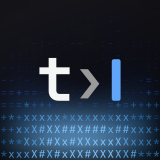
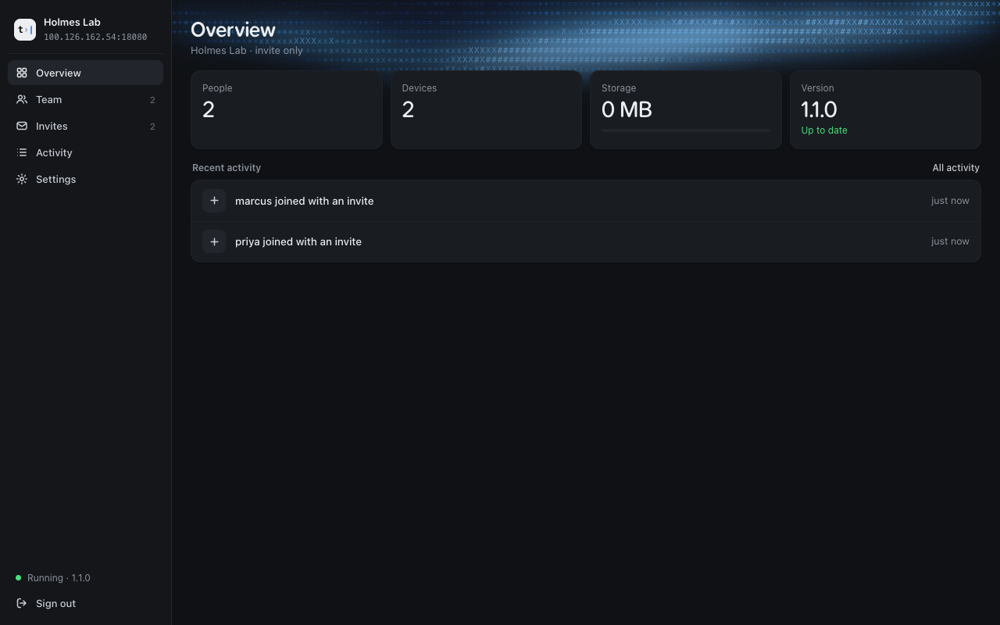
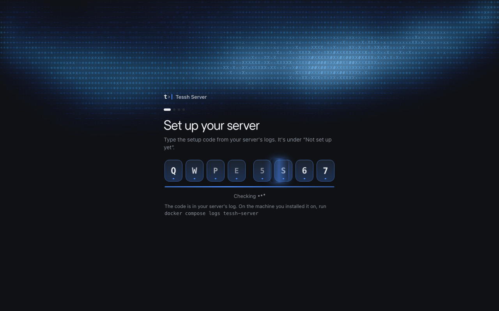
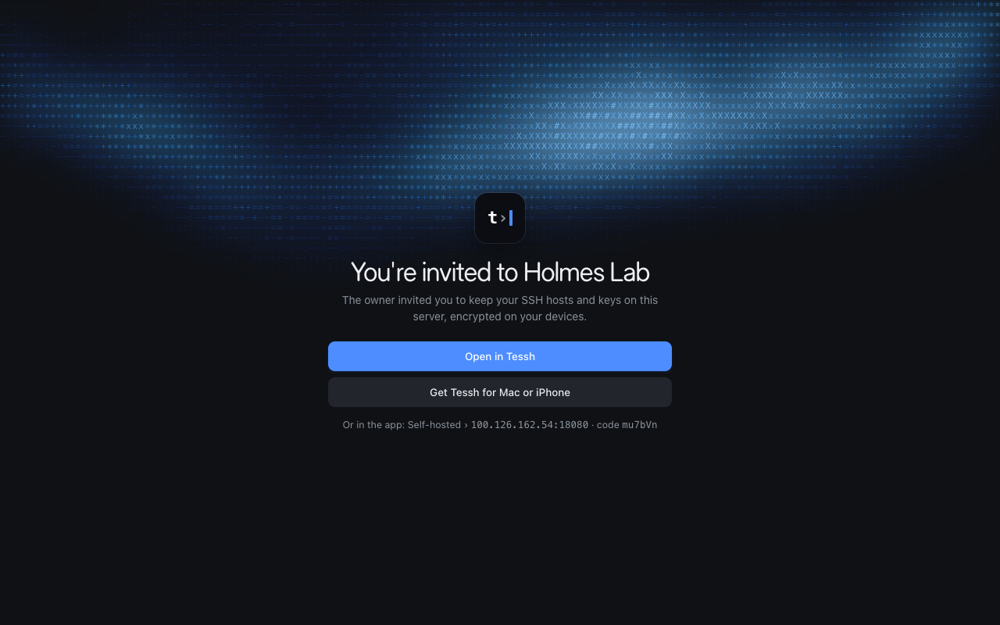

<p align="center">
  
</p>

<h1 align="center">Tessh Server</h1>

<p align="center">
  Run your own sync server for <a href="https://tessh.dev">Tessh</a>, the SSH app for Mac and iPhone.<br>
  One Docker container. One SQLite file. End-to-end encrypted.
</p>



## Install

```sh
curl -fsSLO https://raw.githubusercontent.com/tessh-dev/tessh-server/main/docker-compose.yml
docker compose up -d
docker compose logs tessh-server   # prints your setup code
```

Open `http://<this machine>:8080/setup`, type the code, and finish in the browser.
Put it behind HTTPS before anyone signs in: [reverse proxy examples](docs/install.md).

| 1. Type the setup code | 2. Done: share invite links |
|---|---|
|  |  |

## Connect the apps

Choose **Self-hosted** when signing in to Tessh. You type the address and your code; everyone else just
opens their invite link.

| Invite page | Your public key page |
|---|---|
|  |  |

## What it does

- **Sync** hosts, snippets, settings and synced keys. Encrypted on the device; the server only stores blobs.
- **Key pages** at `https://your-server/<username>` with a one-line installer for your servers.
- **A panel** for people, invites, storage, backups and updates.

## Docs

- [Install, HTTPS, upgrading, locked out](docs/install.md)
- [The panel and key pages](docs/panel.md)
- [Backups and configuration](docs/operations.md)
- [Security](docs/security.md)
- [Development](docs/development.md)

## Licence

Tessh Server is **free to use and source-available** under the [Elastic License 2.0](LICENSE), with one
extra permission so you can host it for other people at no charge.

**Why:** Tessh sync is free. We don't want anyone taking this server and charging people for
something that's meant to cost nothing.

| We're cool with | We're not cool with |
|---|---|
| Running it for yourself, your family or friends | Selling hosted Tessh sync, or bundling it into a paid service |
| Running it for your team or company, including people outside it | Charging anyone for access, directly or indirectly |
| Reading, changing and fixing the code, and sharing your changes | Removing the licence or copyright notices |
| Using it at work, commercially, behind your own login | |

Not sure if your use is fine? Ask: [help@tessh.dev](mailto:help@tessh.dev).
