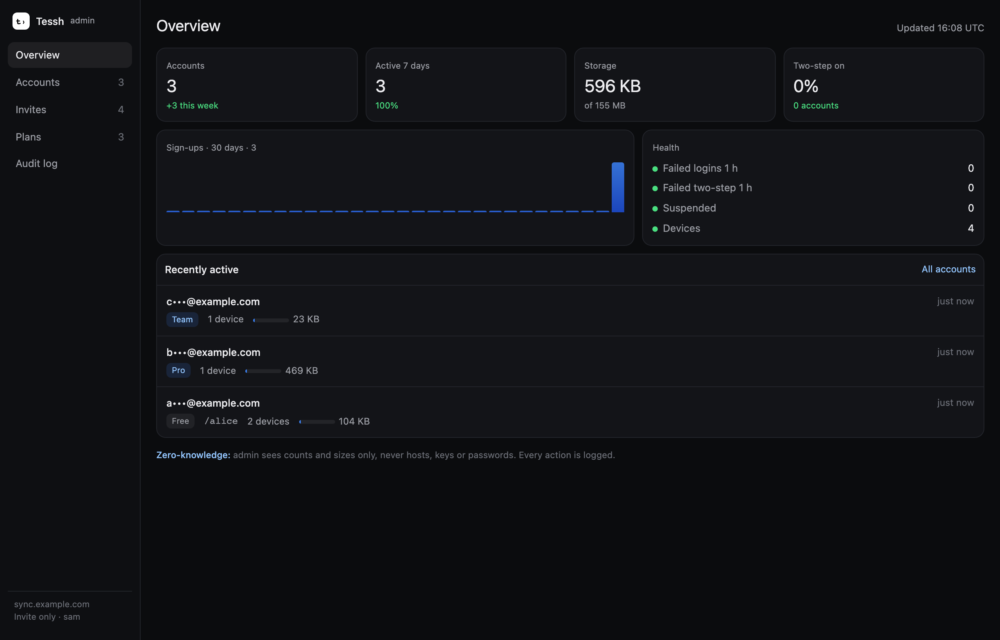
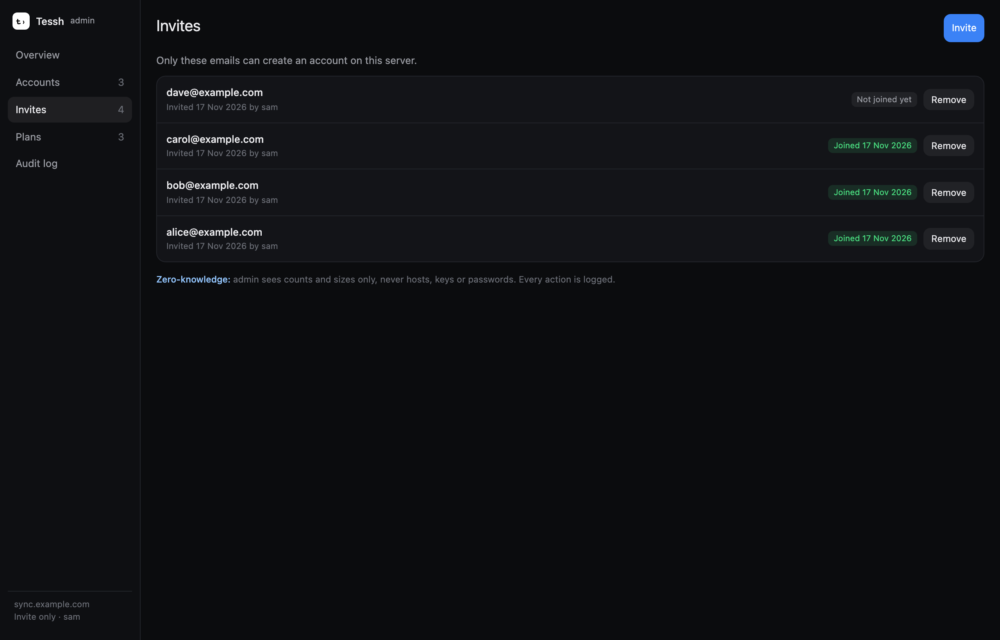
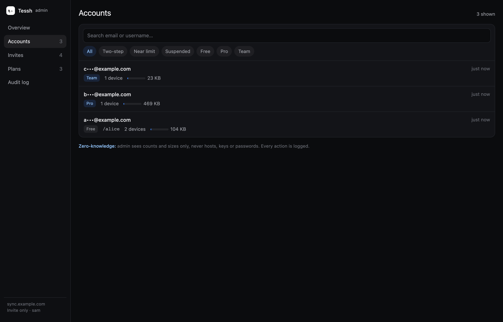
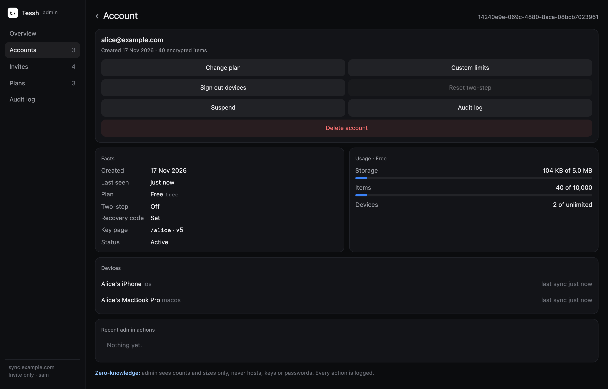
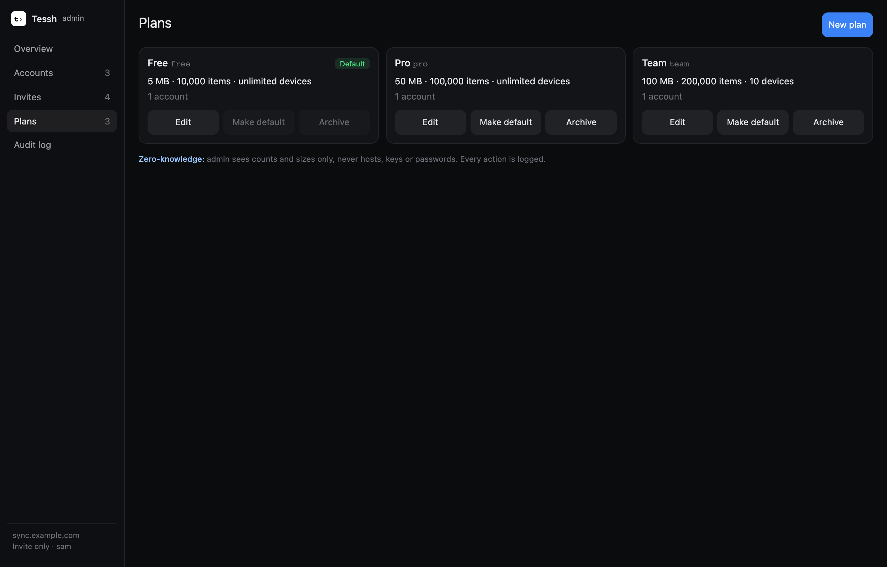
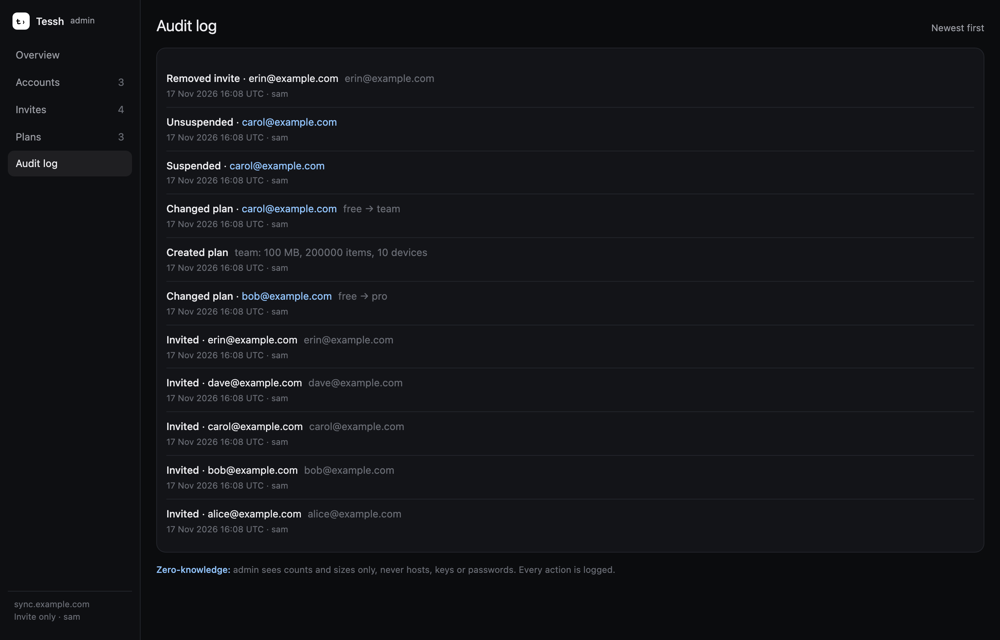

# Tessh Server

The self-hostable sync and key page server for [Tessh](https://tessh.dev), the SSH app for Mac and iPhone.

- **Sync**: hosts, snippets, settings and synced keys travel between your devices through this server.
  Everything is **end-to-end encrypted** on the device before it is sent. The server stores opaque blobs
  and never sees your master password, your vault contents or any private key.
- **Key pages**: each account can publish its public SSH keys at `https://your-server/<username>`,
  with a signed list and a one-line installer for your servers.
- **Admin panel**: accounts, plans and storage limits, suspension, invites and an audit log, on a
  separate port behind a password.

One small Docker image, one SQLite file, no other services.



## Contents

- [Quick start](#quick-start)
- [HTTPS with a reverse proxy](#https-with-a-reverse-proxy)
- [Configuration](#configuration)
- [Invites and the admin panel](#invites-and-the-admin-panel)
- [Connecting the apps](#connecting-the-apps)
- [Key pages](#key-pages)
- [Backups](#backups)
- [Upgrading](#upgrading)
- [Security notes](#security-notes)
- [Development](#development)

## Quick start

You need Docker with Compose, and a domain name pointing at your machine (for HTTPS).

```sh
git clone https://github.com/BobzTH/tessh-server.git
cd tessh-server
```

Edit `docker-compose.yml` and set `PUBLIC_URL` to the address the apps will use, for example
`https://sync.example.com`. Then put an admin password in a `.env` file next to it and start the server:

```sh
echo "ADMIN_PASSWORD=$(openssl rand -base64 24)" > .env
chmod 600 .env
docker compose up -d
docker compose logs -f
```

Check it answers:

```sh
curl http://127.0.0.1:8080/v1/health
# {"ok":true}
curl http://127.0.0.1:8080/v1/server
# {"name":"Tessh","version":"1.0.0","signups":"invite","keysURL":"https://sync.example.com"}
```

The compose file publishes both ports on `127.0.0.1` only: the API (8080) is meant to sit behind a
reverse proxy with HTTPS, and the admin panel (8081) should not be on the internet at all (see
[Security notes](#security-notes)).

Sign-ups start in **invite** mode, so nobody can create an account yet. Open the admin panel, add your
email under **Invites**, then sign up from the app.

## HTTPS with a reverse proxy

The apps need HTTPS. Point your proxy at port 8080. The server reads `X-Forwarded-Proto` and
`X-Forwarded-Host`, which both examples below send.

### Caddy

Caddy gets and renews the certificate on its own:

```caddyfile
sync.example.com {
	reverse_proxy 127.0.0.1:8080
}
```

### nginx

```nginx
server {
    listen 443 ssl;
    http2 on;
    server_name sync.example.com;

    ssl_certificate     /etc/letsencrypt/live/sync.example.com/fullchain.pem;
    ssl_certificate_key /etc/letsencrypt/live/sync.example.com/privkey.pem;

    client_max_body_size 2m;

    location / {
        proxy_pass http://127.0.0.1:8080;
        proxy_set_header Host $host;
        proxy_set_header X-Forwarded-Host $host;
        proxy_set_header X-Forwarded-Proto $scheme;
        proxy_set_header X-Forwarded-For $proxy_add_x_forwarded_for;
    }
}

server {
    listen 80;
    server_name sync.example.com;
    return 301 https://$host$request_uri;
}
```

The server uses a single public URL: `/v1/...` is the API, everything else is key pages. It must be
served from the root of a domain or subdomain, not under a path.

## Configuration

All configuration is through environment variables.

| Variable | Default | Description |
|---|---|---|
| `PUBLIC_URL` | (required) | The public origin of the server, e.g. `https://sync.example.com`. No path. Key page links and install commands use it. |
| `PORT` | `8080` | Port for the API and key pages. |
| `BIND` | `0.0.0.0` | Address the API listens on. |
| `ADMIN_PORT` | `8081` | Port for the admin panel. |
| `ADMIN_BIND` | `0.0.0.0` | Address the admin panel listens on. Inside Docker keep `0.0.0.0` and restrict the published port instead (the compose file uses `127.0.0.1:8081`). |
| `ADMIN_PASSWORD` | (unset) | Password for the admin panel. **If unset, the admin panel is not started**; the API still runs. |
| `SIGNUPS` | `invite` | `open`: anyone can create an account. `invite`: only emails on the invite list. `closed`: no new accounts. |
| `SERVER_NAME` | `Tessh` | Name shown on the home page and reported to the apps. |
| `DATA_DIR` | `/data` | Where the database (`tessh.db`) and `secrets.json` live. |
| `PRELOGIN_SECRET` | (from `secrets.json`) | Optional. Overrides the stored sign-in secret. |
| `TOTP_KEY` | (from `secrets.json`) | Optional. Overrides the stored two-step key: base64 of 32 bytes (`openssl rand -base64 32`). |

### Server secrets

The server needs two secrets: one for sign-in (it keeps unknown emails from being told apart from real
ones) and one that encrypts each account's two-step (TOTP) secret at rest. On first start, if they are
not set in the environment, the server creates both and writes them to `DATA_DIR/secrets.json` with
mode `0600`.

> **Back up `secrets.json` together with the database.** If `TOTP_KEY` is lost or changed, every
> authenticator and backup code enrolled for two-step sign-in stops working, and those people need an
> admin to reset their two-step. Vaults themselves are not affected: they are encrypted by the apps,
> not by these secrets.

## Invites and the admin panel

The admin panel listens on `ADMIN_PORT` (8081) and asks for a user name and password (HTTP Basic). Any
user name works and is recorded in the audit log as who made each change, so use your own name; the
password must match `ADMIN_PASSWORD`.

With the compose file above, reach it through an SSH tunnel from your computer:

```sh
ssh -L 8081:127.0.0.1:8081 you@your-server
# then open http://localhost:8081
```

or over a VPN you already use. Don't expose it to the internet.

### Inviting people

With `SIGNUPS=invite` (the default), only emails on the invite list can create an account:

1. Open **Invites** and choose **Invite**.
2. Enter the person's email. Nothing is sent: tell them the server address yourself.
3. They sign up in the app with that email. The invite then shows **Joined**.

Removing an invite stops that email from signing up. It does not delete an account already made.
Emails are matched case-insensitively.

With `SIGNUPS=closed` nobody can sign up, invited or not. To set up a closed server, start it in
`invite` mode, create the accounts you need, then switch to `closed` and restart.



### What else the admin panel does

- **Accounts**: search, filter by plan, two-step, near-limit or suspended. Each account shows its usage,
  devices and recent admin actions. You can change its plan, set custom limits, sign out all its
  devices, reset two-step (after checking who is asking), suspend it, or delete it.
- **Plans**: storage, item and device limits. New sign-ups get the default plan. Ships with `Free`
  (5 MB, 10,000 items) and `Pro` (50 MB, 100,000 items); edit them or add your own.
- **Audit log**: every admin change, newest first, with who made it.

The admin panel only ever shows counts, sizes, dates, emails, usernames and device names. It cannot show
anyone's hosts, keys, passwords or vault contents: the server doesn't have them.

| Accounts | Account |
|---|---|
|  |  |
| **Plans** | **Audit log** |
|  |  |

## Connecting the apps

In Tessh on the Mac or iPhone: **Sign in › Custom server**, paste your `PUBLIC_URL`
(e.g. `https://sync.example.com`), then create an account or sign in as usual.

The apps check the address with `GET /v1/server`, which returns the server's name, version and
sign-up mode.

| Mac | iPhone |
|---|---|
|  |  |

<!-- Screenshots to add: docs/screenshots/app-custom-server-mac.png and docs/screenshots/app-custom-server-iphone.png -->

Your master password never leaves your devices. If you forget it, the admin cannot recover your vault;
only your recovery code can.

## Key pages

Once someone sets a username in the app and publishes their keys, anyone can fetch them:

| Path | What it serves |
|---|---|
| `/<username>` | A web page in a browser; the raw `authorized_keys` list for `curl` |
| `/<username>/install.sh` | Installer that checks the signature, adds new keys and removes revoked ones |
| `/<username>/authorized_keys`, `/revoked` | The signed lists |
| `/<username>/authorized_keys.sig`, `/revoked.sig` | Their SSH signatures |
| `/<username>/allowed_signers` | The signer line for `ssh-keygen -Y verify` |
| `/<username>/keys.json` | Keys with type, fingerprint and date |

```sh
curl -fsSL https://sync.example.com/alice/install.sh | sh
```

The lists are signed on the person's own devices with a key the server never has. The server checks the
signature before storing a list, and the installer checks it again on the machine it runs on, so the
server can't add a key to anyone's page. Pages show no device names or key labels.


## Backups

Everything lives in `DATA_DIR` (`/data` in the container): `tessh.db` (with `tessh.db-wal` and
`tessh.db-shm` while running) and `secrets.json`. Back up both.

**Simplest: copy the folder while the server is stopped.**

```sh
docker compose stop
docker run --rm -v tessh-server_tessh-data:/data -v "$PWD":/backup alpine \
  tar czf /backup/tessh-$(date +%F).tar.gz -C /data .
docker compose start
```

(The volume name is `<project>_tessh-data`; check it with `docker volume ls`.)

**Without stopping**, use SQLite's online backup, then copy `secrets.json`:

```sh
sqlite3 /path/to/data/tessh.db ".backup '/backups/tessh-$(date +%F).db'"
cp /path/to/data/secrets.json /backups/
```

Never copy `tessh.db` on its own while the server is running: recent changes may still be in the WAL file.

To restore, stop the server, put `tessh.db` and `secrets.json` back into `DATA_DIR` (and remove any
stale `tessh.db-wal` / `tessh.db-shm`), and start it again.

## Upgrading

```sh
docker compose pull
docker compose up -d
```

Database migrations run automatically at start. Each one runs once, in a transaction, and is recorded in
the `schema_migrations` table, so restarting is always safe. Take a backup before upgrading. Releases are
tagged `vX.Y.Z`; pin a tag such as `ghcr.io/bobzth/tessh-server:1.0.0` instead of `latest` if you
prefer to upgrade by hand. To build the image yourself instead, run `docker compose up -d --build`.

## Security notes

- **End-to-end encryption.** The apps encrypt everything before upload. The server stores a hash of a
  key derived from the master password (never the password itself), the encrypted vault key and
  encrypted items. Someone with the database cannot read anyone's vault.
- **Keep the admin panel private.** It is protected by one password with no lockout. Publish it on
  `127.0.0.1` (as the compose file does) and use an SSH tunnel or VPN. Use a long random password.
  Admin writes are refused from other sites (custom header, same-origin and `Sec-Fetch-Site` checks).
- **Always use HTTPS** in front of the API. Sign-in tokens travel in headers.
- **Rate limits.** Password and two-step attempts are limited per account (10 per 15 minutes), recovery
  code attempts more tightly (5 per hour).
  Consider rate limiting at your proxy as well.
- **Logs** never contain request bodies, tokens or keys.
- **`secrets.json`** is created with mode `0600`. Keep backups of it as private as the database.
- The container runs as the unprivileged `node` user and needs nothing but its volume.
- Found a security problem? Please open a private security advisory on GitHub rather than a public issue.

## Development

Needs Node.js 24 or newer (the server uses the built-in `node:sqlite`; it has no runtime dependencies).

```sh
npm install
npm test          # unit and end-to-end tests (vitest)
npm run typecheck
PUBLIC_URL=http://127.0.0.1:8080 DATA_DIR=./data ADMIN_PASSWORD=dev npm run dev
npm run build && npm start   # the compiled output, as the image runs it
```

Layout: `src/index.ts` is the request handler (`fetch(request, env)` style), `src/server.ts` adapts it to
`node:http`, `src/db.ts` is the small SQLite layer, `src/migrate.ts` applies `migrations/*.sql`, and
`src/admin.ts` / `src/admin-ui.ts` are the admin panel.

## Licence

[MIT](LICENSE)
