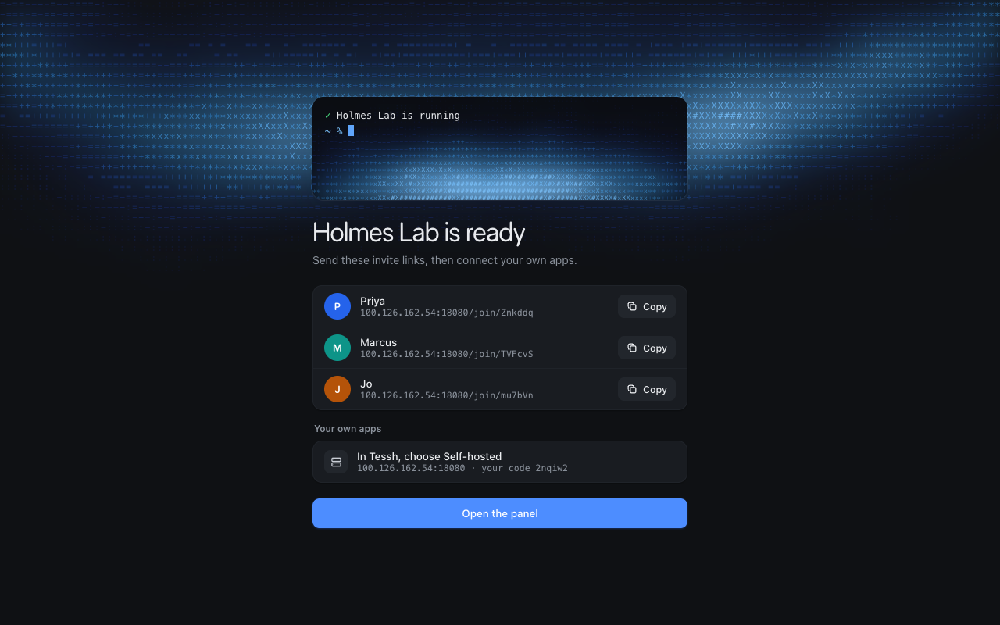
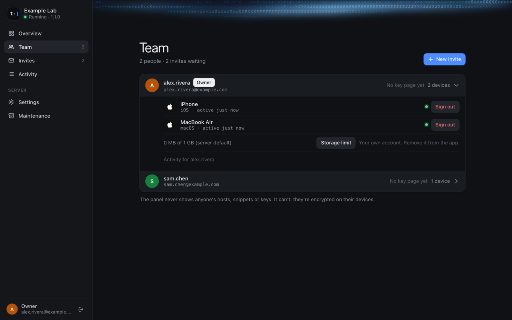
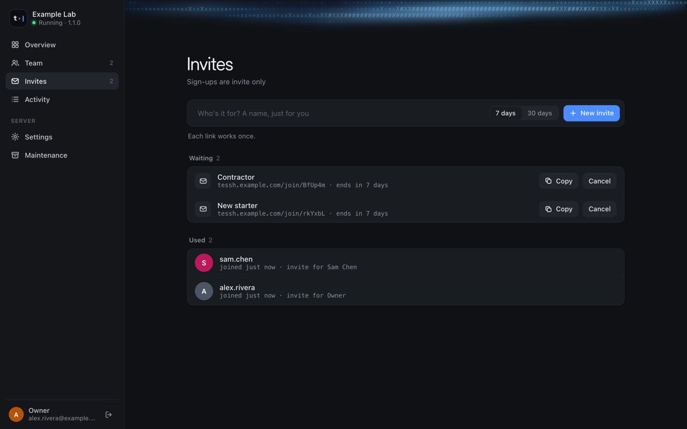
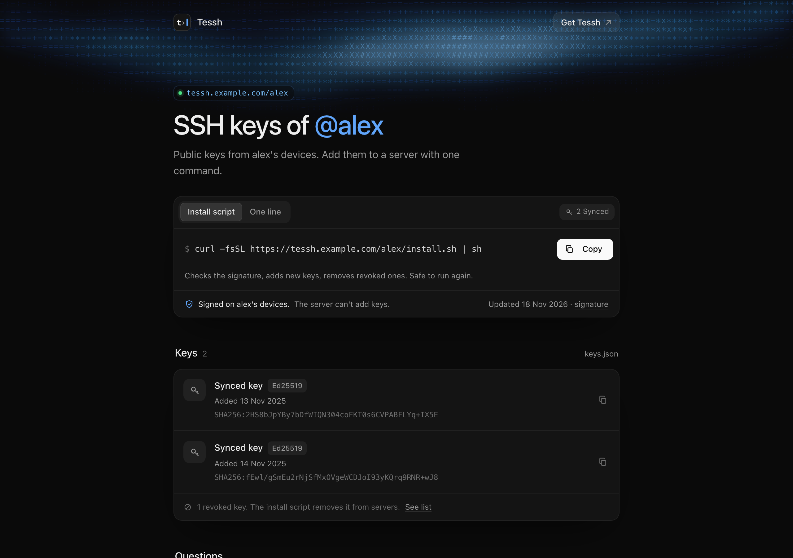

# Tessh Server

The self-hostable sync and key page server for [Tessh](https://tessh.dev), the SSH app for Mac and iPhone.

- **Sync**: hosts, snippets, settings and synced keys travel between your devices through this server.
  Everything is **end-to-end encrypted** on the device before it is sent. The server stores opaque blobs
  and never sees your master password, your vault contents or any private key.
- **Key pages**: each account can publish its public SSH keys at `https://your-server/<username>`,
  with a signed list and a one-line installer for your servers.
- **Set up in the browser, run from a panel**: two commands to install, then finish setup on a web page
  and manage your team (people, invites, storage, backups) from the panel.

One small Docker image, one SQLite file, no other services.


## Contents

- [Quick start](#quick-start)
- [HTTPS with a reverse proxy](#https-with-a-reverse-proxy)
- [Connecting the apps](#connecting-the-apps)
- [The panel](#the-panel)
- [Key pages](#key-pages)
- [Backups](#backups)
- [Upgrading](#upgrading)
- [Locked out](#locked-out)
- [Configuration](#configuration)
- [Security notes](#security-notes)
- [Development](#development)

## Quick start

You need Docker with Compose.

```sh
curl -fsSLO https://raw.githubusercontent.com/tessh-dev/tessh-server/main/docker-compose.yml
docker compose up -d
```

Then read the log:

```sh
docker compose logs tessh-server
```

```text
Tessh server 1.1.0 listening on 0.0.0.0:8080 (public URL from each request, sign-ups: invite)
Not set up yet. Open this to finish setup (works for 24 hours):
  http://<this machine>:8080/setup    or https://your.domain/setup
  Setup code  ABCD-EFGH
```

Open `/setup` on port 8080 of your machine (`http://<this machine>:8080/setup`) and type the setup code.
The page asks for a name, the address the apps will use, an owner login (an email and a password, with an
optional authenticator code) and who can join. It ends with an invite link for each person you named and
a code for your own apps.

| Setup code | Ready |
|---|---|
|  |  |

The setup code works for 24 hours and only until setup is finished.
Setup needs nothing in the compose file: no password, no address, no environment variables.

## HTTPS with a reverse proxy

The apps need HTTPS, so put a reverse proxy in front of port 8080. The server reads `X-Forwarded-Proto`
and `X-Forwarded-Host`, which both examples below send. Once the proxy is up, open
`https://sync.example.com/setup` and use that as the address in setup. Do setup there rather than on
plain port 8080 once the proxy is running: the setup code and your owner password travel over that
connection.

If the proxy runs on the same machine, change the compose port to `"127.0.0.1:8080:8080"` so the server is
only reachable through it.

### Caddy

Caddy gets and renews the certificate on its own:

```caddyfile
sync.example.com {
	reverse_proxy 127.0.0.1:8080
}
```

### nginx

```nginx
server {
    listen 443 ssl;
    http2 on;
    server_name sync.example.com;

    ssl_certificate     /etc/letsencrypt/live/sync.example.com/fullchain.pem;
    ssl_certificate_key /etc/letsencrypt/live/sync.example.com/privkey.pem;

    client_max_body_size 2m;

    location / {
        proxy_pass http://127.0.0.1:8080;
        proxy_set_header Host $host;
        proxy_set_header X-Forwarded-Host $host;
        proxy_set_header X-Forwarded-Proto $scheme;
        proxy_set_header X-Forwarded-For $proxy_add_x_forwarded_for;
    }
}

server {
    listen 80;
    server_name sync.example.com;
    return 301 https://$host$request_uri;
}
```

The server uses a single public URL: `/v1/...` is the API, `/setup` and `/admin` are setup and the panel,
`/join/<code>` is the invite page, and everything else is key pages. It must be served from the root of a
domain or subdomain, not under a path.

## Connecting the apps

In Tessh on the Mac or iPhone, choose **Self-hosted** when you sign in.

- **You** enter the server address and the code shown at the end of setup.
- **Everyone else** opens the invite link you sent them (`https://sync.example.com/join/<code>`). The page
  names who invited them and opens Tessh with the server and code filled in. It also shows the address
  and code to type by hand.


Your master password never leaves your devices. If you forget it, the owner cannot recover your vault;
only your recovery code can.

## The panel

Open `/admin` and sign in with the owner login from setup (and the authenticator code, if you turned it on).

- **Overview**: whether the server is running, its last backup and version, your devices (or your team)
  and recent activity. Before you've signed in from an app, it shows your code.
- **Devices** (just me): your own devices and storage. Sign a device out.
- **Team**: everyone with an account, their devices and storage. Sign a device out, set a storage limit
  for one person, suspend or remove them.
- **Invites**: make an invite link, copy it, cancel it. A link works once and can be set to expire.
- **Activity**: every change made in the panel and every sign-up, newest first.
- **Settings**: server name, address, who can join, default storage, your owner password and
  authenticator, your signed-in browsers and the panel's appearance.
- **Maintenance**: backups and updates.

On a just-me server, Team and Invites are hidden and Devices takes their place.

| Team | Invites |
|---|---|
|  |  |

Who can join is one of **invite only** (the default), **anyone with the address** (fine on a private
network such as Tailscale) or **just me**.

The panel only ever shows counts, sizes, dates, emails, usernames and device names. It cannot show anyone's
hosts, keys, passwords or vault contents: the server doesn't have them.

## Key pages

Once someone sets a username in the app and publishes their keys, anyone can fetch them:

| Path | What it serves |
|---|---|
| `/<username>` | A web page in a browser; the raw `authorized_keys` list for `curl` |
| `/<username>/install.sh` | Installer that checks the signature, adds new keys and removes revoked ones |
| `/<username>/authorized_keys`, `/revoked` | The signed lists |
| `/<username>/authorized_keys.sig`, `/revoked.sig` | Their SSH signatures |
| `/<username>/allowed_signers` | The signer line for `ssh-keygen -Y verify` |
| `/<username>/keys.json` | Keys with type, fingerprint and date |

```sh
curl -fsSL https://sync.example.com/alice/install.sh | sh
```

The lists are signed on the person's own devices with a key the server never has. The server checks the
signature before storing a list, and the installer checks it again on the machine it runs on, so the
server can't add a key to anyone's page. Pages show no device names or key labels.



## Backups

The server keeps a copy of its database for you: a nightly backup at 03:00 server time into
`/data/backups/`, the newest 7 kept. It is one SQLite file (`tessh-YYYY-MM-DD.db`), made so it is safe
while the server runs.

To take one now, open **Maintenance** in the panel and choose **Download a backup**. It asks for the owner
password first.

Everything lives in the `/data` volume: `tessh.db`, `secrets.json` and the `backups` folder. **Back up
`secrets.json` as well**, and keep copies somewhere other than this machine. To copy the whole volume:

```sh
docker compose stop
docker run --rm -v tessh-server_tessh-data:/data -v "$PWD":/backup alpine \
  tar czf /backup/tessh-$(date +%F).tar.gz -C /data .
docker compose start
```

(The volume name is `<project>_tessh-data`; check it with `docker volume ls`.)

To restore, stop the server, put `tessh.db` (or a downloaded backup renamed to `tessh.db`) and
`secrets.json` back into the volume, remove any stale `tessh.db-wal` and `tessh.db-shm`, and start it again.

## Upgrading

```sh
docker compose pull
docker compose up -d
```

Database migrations run automatically at start. Each one runs once, in a transaction, so restarting is
always safe. Take a backup before upgrading. When a newer release exists, the panel says so in the sidebar
and under **Maintenance**. Releases are tagged `vX.Y.Z`; pin a tag such as `ghcr.io/tessh-dev/tessh-server:1.1.0`
instead of `latest` if you prefer to upgrade by hand. To build the image yourself instead, run
`docker compose up -d --build`.

## Locked out

If you lose the owner password (or the authenticator), reset the owner login. Your data and everyone's
accounts are untouched.

```sh
docker compose exec tessh-server tessh-server reset-owner
docker compose restart tessh-server
docker compose logs tessh-server
```

The log prints a new setup code. Open `/setup`, type it and choose a new owner login.

## Configuration

Nothing here is required: setup asks for the name, address and sign-up mode in the browser, and you can
change them later in the panel. Set one of these in the compose file only to fix it. A setting fixed this
way is locked in the panel.

| Variable | Default | Description |
|---|---|---|
| `PUBLIC_URL` | (optional) | The public origin of the server, e.g. `https://sync.example.com`. No path. Key page links and install commands use it. |
| `SERVER_NAME` | `Tessh` | Name shown on the home page and in the apps. |
| `SIGNUPS` | `invite` | `open`: anyone can create an account. `invite`: only people with an invite link. `closed`: no new accounts. |
| `UPDATE_CHECK` | `true` | `false` turns off the daily check for a newer release. This check is the only call the server makes to another site: it asks GitHub for the latest release number and sends nothing about you. |
| `PORT` | `8080` | Port to listen on. |
| `BIND` | `0.0.0.0` | Address to listen on. |
| `DATA_DIR` | `/data` | Where the database (`tessh.db`), backups and `secrets.json` live. |
| `PRELOGIN_SECRET` | (from `secrets.json`) | Optional. Overrides the stored sign-in secret. |
| `TOTP_KEY` | (from `secrets.json`) | Optional. Overrides the stored two-step key: base64 of 32 bytes (`openssl rand -base64 32`). |

### Server secrets

The server needs two secrets: one for sign-in (it keeps unknown emails from being told apart from real
ones) and one that encrypts each account's two-step (TOTP) secret at rest. On first start, if they are
not set in the environment, the server creates both and writes them to `DATA_DIR/secrets.json` with
mode `0600`.

> **Back up `secrets.json` together with the database.** If `TOTP_KEY` is lost or changed, every
> authenticator and backup code enrolled for two-step sign-in stops working, and those people need the
> owner to reset their two-step. Vaults themselves are not affected: they are encrypted by the apps,
> not by these secrets.

## Security notes

- **End-to-end encryption.** The apps encrypt everything before upload. The server stores a hash of a
  key derived from the master password (never the password itself), the encrypted vault key and
  encrypted items. Someone with the database cannot read anyone's vault.
- **Always use HTTPS** in front of the server. Sign-in tokens and the owner session travel in headers and
  cookies. Setup warns you when the address isn't HTTPS.
- **Protect the owner login.** Use a long password and turn on the authenticator code. Panel writes are
  refused from other sites, and downloading a backup needs the owner password again.
- **Rate limits.** Password and two-step attempts are limited per account (10 per 15 minutes), recovery
  code attempts more tightly (5 per hour). Owner sign-ins allow 5 failures per address in 15 minutes, and
  after 200 failures from all addresses together everyone waits out the 15 minutes. Wrong invite codes allow
  10 per address and 200 in all per 15 minutes. Consider rate limiting at your proxy as well.
- **Client addresses.** The server trusts `X-Forwarded-For` only when the connection comes from a loopback
  or private address (a reverse proxy on the same machine or network). Anything else is limited by the
  address it connects from, so don't expose a private-network proxy that passes through headers from
  untrusted clients.
- **Logs** never contain request bodies, tokens or keys.
- **`secrets.json`** is created with mode `0600`. Keep backups of it as private as the database.
- **No tracking, one outbound call.** The only request the server makes is the daily update check
  (`UPDATE_CHECK=false` stops it).
- The container runs as the unprivileged `node` user and needs nothing but its volume.
- Found a security problem? Please open a private security advisory on GitHub rather than a public issue.

## Development

Needs Node.js 24 or newer (the server uses the built-in `node:sqlite`; it has no runtime dependencies).

```sh
npm install
npm test          # unit and end-to-end tests (vitest)
npm run typecheck
PUBLIC_URL=http://127.0.0.1:8080 DATA_DIR=./data npm run dev
npm run build && npm start   # the compiled output, as the image runs it
```

Layout: `src/index.ts` is the request handler (`fetch(request, env)` style), `src/server.ts` adapts it to
`node:http`, `src/db.ts` is the small SQLite layer, `src/migrate.ts` applies `migrations/*.sql`, and
`src/web/` holds the setup, panel and invite pages. The design is in
[docs/design/web-setup-and-panel.md](docs/design/web-setup-and-panel.md).

## Licence

[MIT](LICENSE)
