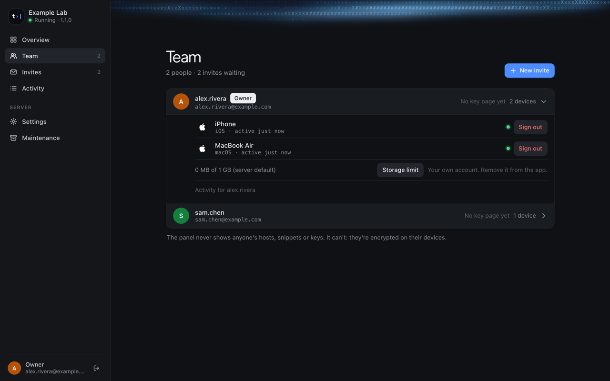
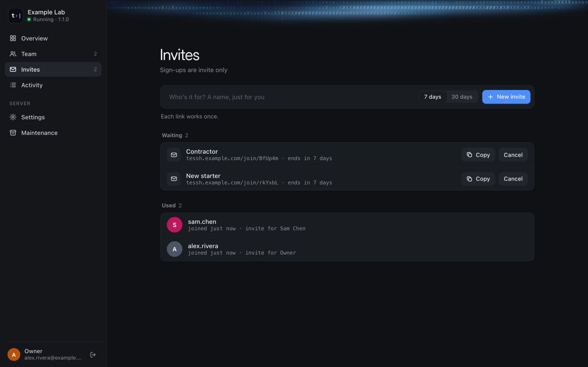
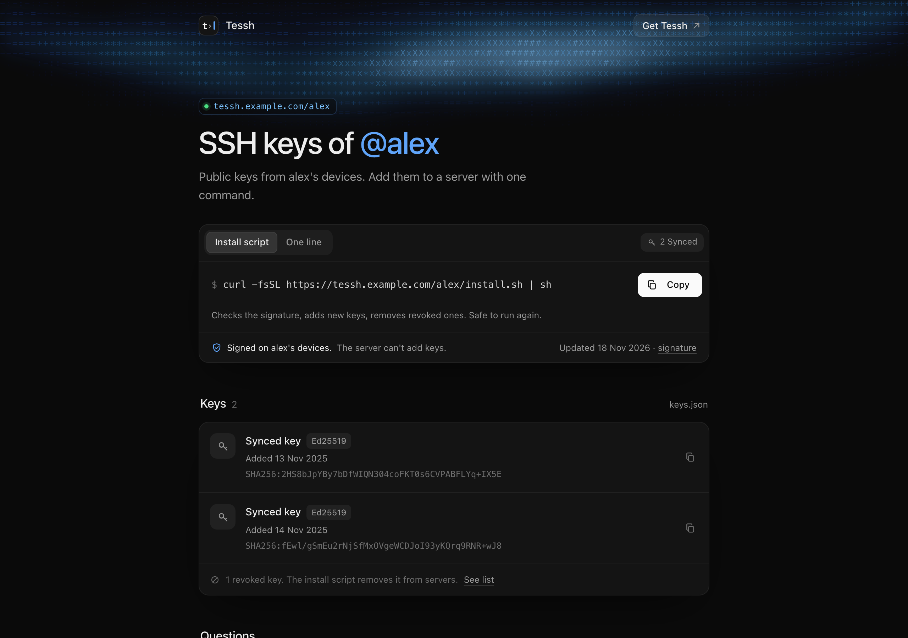

# The panel and key pages

## The panel

Open `/admin` and sign in with the owner login from setup (and the authenticator code, if you turned it on).

- **Overview**: whether the server is running, its last backup and version, your devices (or your team)
  and recent activity. Before you've signed in from an app, it shows your code.
- **Devices** (just me): your own devices and storage. Sign a device out.
- **Team**: everyone with an account, their devices and storage. Sign a device out, set a storage limit
  for one person, suspend or remove them.
- **Invites**: make an invite link, copy it, cancel it. A link works once and can be set to expire.
- **Activity**: every change made in the panel and every sign-up, newest first.
- **Settings**: server name, address, who can join, default storage, your owner password and
  authenticator, your signed-in browsers and the panel's appearance.
- **Maintenance**: backups and updates.

On a just-me server, Team and Invites are hidden and Devices takes their place.

| Team | Invites |
|---|---|
|  |  |

Who can join is one of **invite only** (the default), **anyone with the address** (fine on a private
network such as Tailscale) or **just me**.

The panel only ever shows counts, sizes, dates, emails, usernames and device names. It cannot show anyone's
hosts, keys, passwords or vault contents: the server doesn't have them.


## Key pages

Once someone sets a username in the app and publishes their keys, anyone can fetch them:

| Path | What it serves |
|---|---|
| `/<username>` | A web page in a browser; the raw `authorized_keys` list for `curl` |
| `/<username>/install.sh` | Installer that checks the signature, adds new keys and removes revoked ones |
| `/<username>/authorized_keys`, `/revoked` | The signed lists |
| `/<username>/authorized_keys.sig`, `/revoked.sig` | Their SSH signatures |
| `/<username>/allowed_signers` | The signer line for `ssh-keygen -Y verify` |
| `/<username>/keys.json` | Keys with type, fingerprint and date |

```sh
curl -fsSL https://sync.example.com/alice/install.sh | sh
```

The lists are signed on the person's own devices with a key the server never has. The server checks the
signature before storing a list, and the installer checks it again on the machine it runs on, so the
server can't add a key to anyone's page. Pages show no device names or key labels.



[← Back to the README](../README.md)
